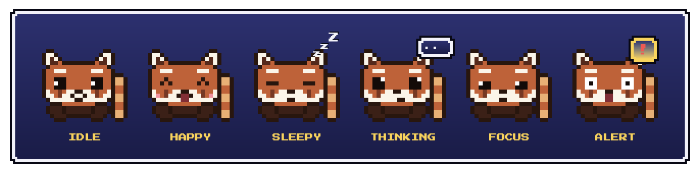
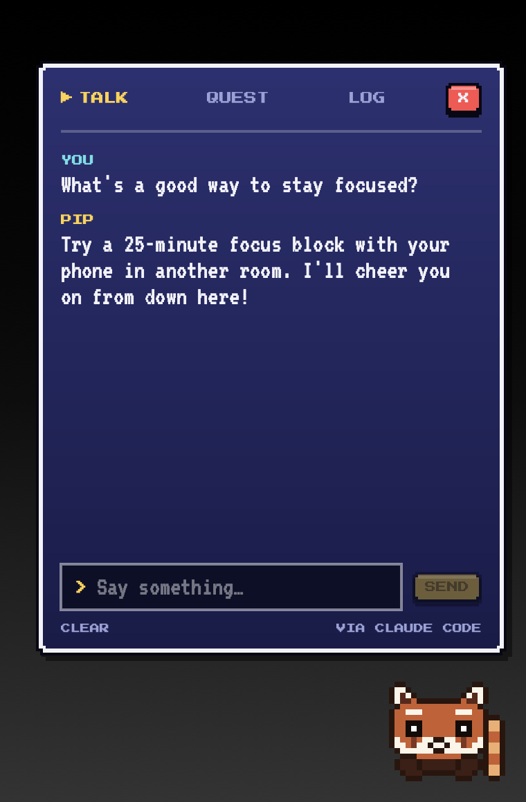
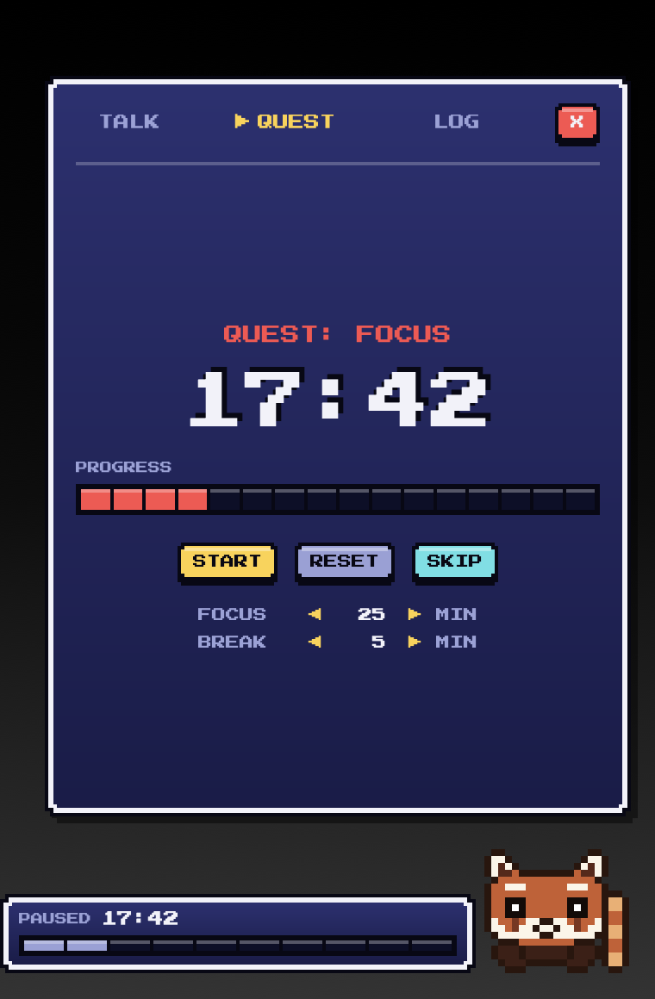
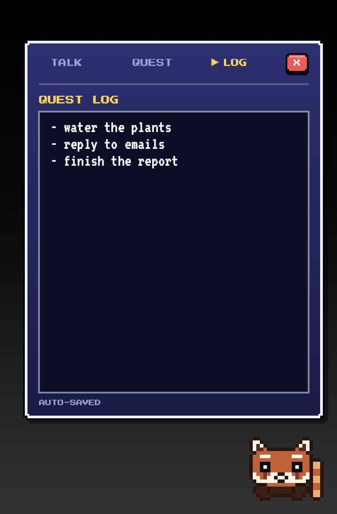
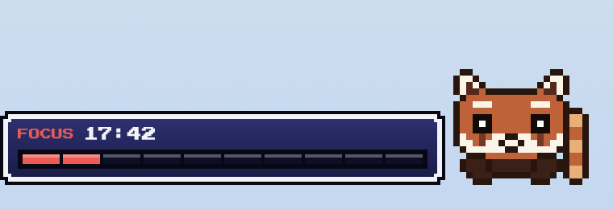

# Pip: a pixel red panda for your Mac

Pip is a tiny 8-bit red panda that lives in the bottom-right corner of your
screen. It floats above every window, including full-screen apps, and stays out
of your way: clicks pass straight through to whatever is underneath, except on
Pip itself. Click Pip to open a little game-style menu with a Claude chat, a
focus timer, and a notepad.



<p>
  
  
  
</p>

## Features

- **Talk.** Chat with Claude in a retro dialog window. Messages go through the
  Claude Code app you're already logged into, so they use your Claude
  subscription rather than API credits.
- **Quest.** A Pomodoro-style focus and break timer with a segmented progress
  bar. While a timer runs or is paused, a small status window sits next to Pip.
  When time's up, Pip shows a "!" badge, hops, and plays a level-up jingle.
- **Log.** A scratchpad that saves automatically.
- **A pet with moods.** Pip's eyes follow your cursor and it blinks. When you
  hover over it, it does a little hop and looks up at you with sparkly eyes. It
  looks happy when you click, determined during a focus session, and shows
  "..." while Claude is replying. It falls asleep after 10 minutes without mouse
  movement. If a reply arrives while the menu is closed, a small cyan dot
  appears on its ear.
- **Calm by design.** Pip mostly sits still, with one small sway or hop every
  15 to 30 seconds. It never pops up text on its own.
- **Sleeps when your Mac does.** Pip hides when the Mac goes to sleep or the
  lid closes, and comes back when you wake it. A running timer pauses while
  you're away. Screen lock and the screensaver don't count, so Pip stays put.
- **Light on battery.** Motion runs in the macOS compositor, so Pip idles
  under 1% CPU and about 20 MB of memory.
- **Chiptune sound effects**, synthesized in code. You can turn them off.



## Install

You need macOS 13 or later and the Xcode command line tools
(`xcode-select --install`). There's no Xcode project; one script builds it.

```sh
git clone https://github.com/Aidenn8/pip-desktop-pet.git
cd pip-desktop-pet
./build.sh --install
```

That builds `DesktopPet.app`, copies it to `~/Applications`, and launches it.
Run `./build.sh` without the flag to build into `build/` only.

The app is signed ad hoc for your own Mac. Because you build it yourself,
macOS doesn't block it the way it would block a downloaded unsigned app.

### Chat setup

The Talk tab needs [Claude Code](https://claude.com/claude-code) installed and
logged in with your Claude account. If you can run `claude` in Terminal, you're
set. Pip finds it in the usual install locations or through your login shell.

## Using Pip

- **Click Pip** to open or close the menu. Press Escape to close it too.
- **The game controller icon** in the menu bar has everything else: show or
  hide Pip, move it to the screen your cursor is on, jump to a tab, start a
  focus session, toggle sound effects, toggle Open at Login, and quit.
- **Open at Login** brings Pip back after a restart. It's off until you turn
  it on.

## How the chat works

Each message runs Claude Code once in headless mode, roughly:

```sh
claude -p --output-format json --tools "" --strict-mcp-config \
  --effort low --system-prompt "<Pip's personality>" [--resume <session>]
```

- **Model.** Pip uses whatever default model you've set in Claude Code.
- **Reasoning effort.** Low, so replies are quick and light on your plan's
  usage. A short message is a few hundred tokens.
- **No tools.** Pip's chat can't read files, run commands, or browse.
- **Memory.** Follow-up messages resume the same Claude Code session, so Pip
  remembers the conversation. CLEAR starts a new one.
- **Where chats are stored.** Claude Code saves them like any other session,
  under a private folder
  (`~/Library/Application Support/DesktopPet/chat`), so they don't mix into
  your projects.
- **Billing safety.** Pip removes `ANTHROPIC_API_KEY` and similar variables
  before launching Claude Code, so an API key in your environment can't quietly
  switch it to API billing.

Your messages count toward your Claude plan's usage limits like any other
Claude use. Each reply takes a few seconds because Claude Code starts fresh
for every message.

## Project layout

```
Sources/
  main.swift       App startup, the floating window, menu bar item, cursor
                   tracking and click-through, sleep/wake, Core Animation motion
  PetView.swift    The pixel-art sprite and its face for each mood
  CardView.swift   The Talk, Quest and Log menu
  Theme.swift      Pixel fonts, colors, window frames, buttons, chiptune sounds
  PetModel.swift   Shared state and moods, plus window layout constants
  Chat.swift       Runs Claude Code headlessly for the chat
  Pomodoro.swift   The focus/break timer
  Notes.swift      The auto-saving notepad
Resources/Fonts/   Press Start 2P and VT323 (SIL Open Font License)
tools/snapshot/    Renders every mood and screen to PNGs (used for docs/images)
build.sh           Compiles with swiftc and assembles the .app bundle
Info.plist         App bundle settings
```

To regenerate the screenshots:

```sh
tools/snapshot.sh docs/images-new
```

## Making it yours

- **Change the character.** Pip is drawn from a grid of letters in
  `Sources/PetView.swift`, one letter per pixel, with a color for each letter.
  Edit `Sprite.body` and `Sprite.colors`, then adjust the eye and mouth
  positions in `Sprite.face`.
- **Move it.** `Layout.screenInset` in `Sources/PetModel.swift` sets how far
  Pip sits from the screen corner.
- **Change its personality.** The system prompt is at the top of
  `Sources/Chat.swift`, along with the effort level.

## Where your data lives

Everything stays on your Mac:

- Notes: `~/Library/Application Support/DesktopPet/notes.txt`
- Chat sessions: Claude Code's normal session history
- Settings such as timer lengths and sound: macOS user defaults

## Credits

- Fonts: [Press Start 2P](https://fonts.google.com/specimen/Press+Start+2P) by
  The Press Start 2P Project Authors and
  [VT323](https://fonts.google.com/specimen/VT323) by The VT323 Project Authors,
  both under the SIL Open Font License. Copies of the licenses are in
  `Resources/Fonts`.
- Built with [Claude Code](https://claude.com/claude-code).

## License

The code is released under the [MIT License](LICENSE). The bundled fonts keep
their own licenses.
